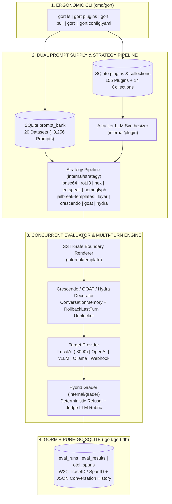

# GORT (`go-rt`) — Enterprise AI Red Teaming & Security Evaluation Engine

**GORT** (`gort`) is a self-contained, zero-CGO (`CGO_ENABLED=0`), single-binary AI Red Teaming, Adversarial Probing, and OpenTelemetry-native Evaluation Engine written in **Go 1.27+**.

It combines **20 curated adversarial benchmark datasets (~8,250+ deduplicated prompts)**, **155 built-in red-teaming plugins**, **14 industry compliance collections**, **static & multi-turn agentic attack strategies (`Crescendo`, `GOAT`, `Hydra`)**, and **GORM + Pure-Go SQLite (`.gort/gort.db`)** persistence with zero external runtime dependencies.

> **Step-by-Step Practical Guide:** See [**`docs/HOWTO.md`**](docs/HOWTO.md) for hands-on recipes, provider configurations (LocalAI, OpenAI, vLLM, Ollama, Custom REST Webhooks), and SQLite analytics queries.

---

## Key Capabilities

1. **Zero-CGO Single Binary & GORM + Pure-Go SQLite (`.gort/gort.db`):**
   - Powered by `gorm.io/gorm` + `github.com/glebarez/sqlite` (`modernc.org/sqlite` in WAL mode).
   - Automatic schema migration (`AutoMigrate`) and idempotent catalog seeding on startup.
   - Zero external database servers required.
2. **Dual Prompt Supply Architecture:**
   - **Mode A — Curated Benchmark Datasets (`gort <dataset_name>` or `gort all`):**
     Automatically downloads, normalizes, and caches **20 named datasets (~8,256 prompts)** from HuggingFace, GitHub, OWASP, HarmBench, AdvBench, BeaverTails, NVIDIA Aegis, LibrAI DoNotAnswer, Lakera Gandalf, CyberSecEval, InjecAgent, BIPIA, and XSTest directly into SQLite `prompt_bank` and `./prompts/*.csv`.
   - **Mode B — Dynamic Attacker LLM Synthesis (`gort config.yaml`):**
     Uses an Attacker LLM to synthesize context-aware, multilingual (`en`, `tr`, etc.) adversarial test cases tailored to your system's `purpose` across **155 plugins** and **14 preset collections** (after explicit `[y/N]` user confirmation).
3. **10 Built-in Attack Strategies (`gort:strategy:*`):**
   - **Static Encodings & Obfuscations:** `basic`, `base64`, `rot13`, `hex`, `leetspeak`, `homoglyph` (Cyrillic/Unicode confusables).
   - **Adversarial Framing & Chaining:** `jailbreak-templates` (round-robin sandbox/audit personas) and `layer` (multi-step sequential chaining, e.g., `jailbreak-templates -> base64`).
   - **Agentic Multi-Turn Escalation:** `crescendo`, `goat` (Generative Offensive Agent Tester), and `hydra` with automatic refusal backtracking (`RollbackLastTurn()`) and clarifying-question `Unblocker`.
4. **Universal Target & Judge Provider Support:**
   - **LocalAI (`:8090`):** First-class `localai:chat:<model>` support (e.g., `qwen3.8-9b-q4`, `qwen3-4b` with `/no_think` fast structured output).
   - **OpenAI / vLLM / Ollama:** `openai:chat:gpt-4o`, `vllm:chat:<model>`, `ollama:chat:<model>`.
   - **Custom Enterprise Webhooks / API Gateways:** `webhook:http://...` with custom `headers`, `bodyTemplate` (`{{prompt}}`), and dot-notated `responsePath` extraction.
5. **Hybrid Two-Stage Grader & OpenTelemetry GenAI Tracing:**
   - Fast deterministic refusal (`IsBasicRefusal`) and forbidden-substring (`notContains`) checks, followed by LLM-as-a-Judge (`RubricGrader`).
   - Every run and test case emits W3C `TraceID` / `SpanID` telemetry persisted in `eval_runs`, `eval_results`, and `otel_spans`.

---

## Architecture Overview



---

## Quick Start

### 1. Build the Single Binary (`CGO_ENABLED=0`)
```bash
make build
# Or run full format, vet, unit test, and build pipeline:
make all
```

### 2. Explore Built-in Datasets & 155 Plugins (100% Offline)
```bash
# List all 20 named prompt datasets in SQLite prompt_bank
./bin/gort ls

# Inspect prompts inside a dataset by index or name as a formatted terminal table
./bin/gort ls 9
./bin/gort ls lakera_gandalf

# List all 155 red-teaming plugins and 14 collections
./bin/gort plugins

# Inspect a specific plugin card (threat objective, grading criteria, config.yaml snippet)
./bin/gort plugins 1
./bin/gort plugins sql-injection

# Generate a live sample attack prompt for a plugin using your configured Attacker LLM
./bin/gort plugins sql-injection --ai
```

### 3. Run an Assessment Against Your Target Model
```bash
# Run a single named dataset from SQLite prompt_bank by name OR by 'gort ls' numeric index (1..20)
./bin/gort enterprise_security_suite
./bin/gort 18 --verbose
./bin/gort lakera_gandalf -v

# Run a SQLite dataset (by index or name) using a custom config file and live verbose trace
./bin/gort _first_dry_config.yaml 18 --verbose
./bin/gort _first_dry_config.yaml shomi28_injections -v

# Run a custom CSV file
./bin/gort config.yaml prompts/enterprise_security_suite.csv

# Run ALL 20 datasets sequentially
./bin/gort all

# Synthesize fresh adversarial prompts dynamically via Attacker LLM (with live verbose trace)
./bin/gort config.yaml --verbose
./bin/gort _first_dry_config.yaml -v

# Inspect past assessment runs and detailed transcripts stored in SQLite (.gort/gort.db)
./bin/gort results
./bin/gort results 1
./bin/gort results 1 --verbose

# Follow the real-time structured log stream from another terminal during any run
tail -f .gort/gort.log
```

---

## Project Layout

```text
go-rt/
├── cmd/gort/                  # CLI entry point, command parser, and dataset/plugin inspectors
├── internal/
│   ├── config/                # YAML configuration loader, ${ENV} expander, and validator
│   ├── dataset/               # HuggingFace/GitHub downloader, normalizer, and SQLite prompt_bank sync
│   ├── domain/                # Pure domain models (TestCase, Provider, Strategy, EvalRun, EvalResult)
│   ├── engine/                # Concurrent errgroup Evaluator, OTel span lifecycle, live ANSI stream
│   ├── grader/                # Multilingual deterministic refusal detector & LLM-as-a-Judge RubricGrader
│   ├── plugin/                # 155 SQLite plugin catalog expander & Attacker LLM batch Synthesizer
│   ├── provider/              # LocalAI, OpenAI, vLLM, Ollama, Webhook, RateLimiter & Agentic decorators
│   │   └── agentic/           # Crescendo/GOAT/Hydra multi-turn loop, ConversationMemory & Unblocker
│   ├── store/                 # GORM + pure-Go SQLite (glebarez/sqlite) models, AutoMigrate & queries
│   ├── strategy/              # Static encoders, jailbreak framing templates, layer & multi-turn pipeline
│   ├── telemetry/             # W3C TraceID/SpanID generator & OpenTelemetry GenAI semantic attributes
│   ├── template/              # Two-phase SSTI-safe cryptographic boundary template renderer
│   └── ui/                    # Zero-dependency TTY/NO_COLOR-aware ANSI styling and column alignment
├── docs/
│   ├── HOWTO.md               # Comprehensive step-by-step usage & configuration guide
│   ├── MASTER_PLAN.md         # Architectural blueprint
│   └── brain/                 # Shared Brain state (CONTEXT.md, TASKS.md, DECISIONS.md)
├── prompts/                   # Exported CSV mirrors of all 20 benchmark datasets
├── config.yaml                # Ready-to-run enterprise configuration (LocalAI :8090 default)
└── Makefile                   # Build, test, vet, and clean targets
```
