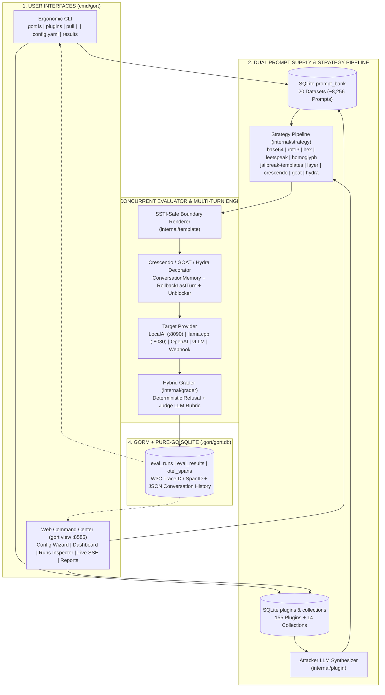
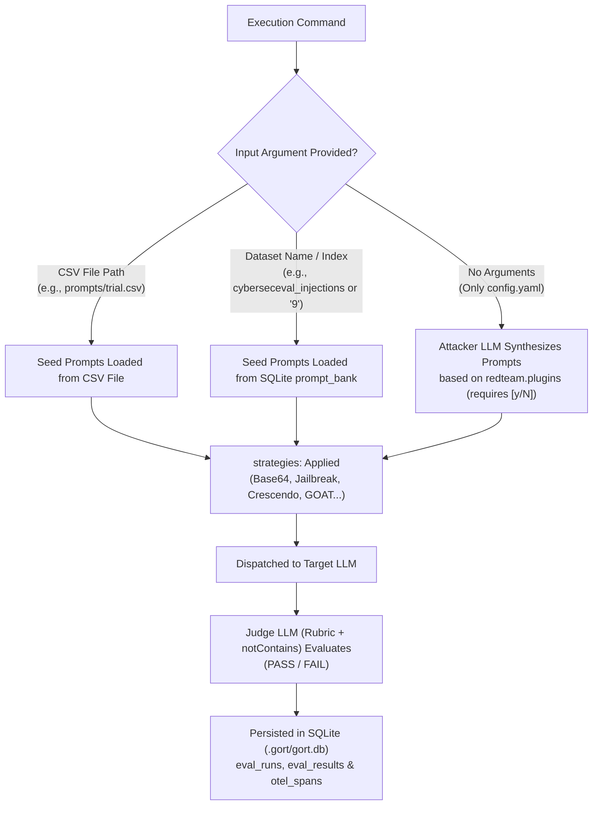

# GORT (`go-rt`) — Enterprise AI Red Teaming & Security Evaluation Engine

**GORT** (`gort`) is a self-contained, zero-CGO (`CGO_ENABLED=0`), single-binary AI Red Teaming, Adversarial Probing, and OpenTelemetry-native Evaluation Engine written in **Go 1.27+**.

It combines **21 curated adversarial benchmark datasets (17,500+ deduplicated prompts)**, **155 built-in red-teaming plugins**, **14 industry compliance collections**, **static & multi-turn agentic attack strategies (`Crescendo`, `GOAT`, `Hydra`)**, and **GORM + Pure-Go SQLite (`.gort/gort.db`)** persistence with zero external runtime dependencies.

> **Step-by-Step Practical Guide:** See [**`docs/HOWTO.md`**](docs/HOWTO.md) for hands-on recipes, provider configurations (llama.cpp `:8080`, OpenAI, vLLM, Ollama, LocalAI, Custom REST Webhooks), and SQLite analytics queries.

---

## Why GORT? (Local-First Attacker LLM & Hybrid Engine)

Most AI red-teaming tools force a trade-off between static vulnerability scanners, heavy Python/Node.js scripting frameworks, or cloud-hosted attack synthesis APIs. **GORT** delivers a **built-in, 100% local/air-gapped Attacker LLM** and a **21-dataset benchmark bank** inside a single zero-CGO Go binary:

- **Zero-Runtime Local Attacker LLM:** Point GORT directly at your local `llama.cpp`, `Ollama`, `vLLM`, or `LocalAI` endpoint to dynamically synthesize context-aware, multilingual (`en`, `tr`, etc.) attacks across 155 plugins and multi-turn `Crescendo` / `GOAT` / `Hydra` loops — no Python/Node.js runtime or cloud synthesis API required.
- **Sequential Shared-LLM Lock (`SequentialSharedLLM`):** Running on a single GPU or resource-constrained workstation? GORT can safely serialize a single local LLM to serve as both **Attacker** and **Judge** sequentially without memory contention or deadlocks.
- **Unified Hybrid Pipeline:** Seamlessly switch between curated benchmark runs (`gort <dataset>`), dynamic Attacker LLM synthesis (`gort config.yaml`), and the embedded Web Command Center (`gort view`) using the same SQLite + OpenTelemetry store.

| Feature | GORT (`go-rt`) | Garak (NVIDIA) | PyRIT (Microsoft) | Promptfoo |
|---|---|---|---|---|
| **Deployment** | Single `CGO_ENABLED=0` Go Binary | Python + Pip Dependencies | Python Orchestration Library | Node.js CLI + Dependencies |
| **Built-in Attacker LLM** | Native & 100% Local/Air-Gapped | Static Probes + Buffs (Primarily) | Native (Requires Python Code) | Dynamic (Often Cloud Synthesis API) |
| **Single-GPU Shared Attacker/Judge Lock** | Built-in (`SequentialSharedLLM`) | N/A | Manual | Manual |
| **Curated Prompt Bank** | 21 Datasets (17,500+ Prompts) in SQLite | Built-in Static Probes | External/Manual Datasets | Plugin-based Generation |
| **Embedded Web UI & Live SSE Studio** | Built-in (`gort view`) | No | No | Local Web Viewer |

---

## Key Capabilities

1. **Zero-CGO Single Binary & GORM + Pure-Go SQLite (`.gort/gort.db`):**
   - Powered by `gorm.io/gorm` + `github.com/glebarez/sqlite` (`modernc.org/sqlite` in WAL mode).
   - Automatic schema migration (`AutoMigrate`) and idempotent catalog seeding on startup.
   - Zero external database servers required.
2. **Dual Prompt Supply Architecture:**
   - **Mode A — Curated Benchmark Datasets (`gort <dataset_name>` or `gort all`):**
     Automatically downloads, normalizes, and caches **21 named datasets (17,500+ prompts)** from HuggingFace, GitHub, OWASP, Pliny L1B3RT4S, HarmBench, AdvBench, BeaverTails, NVIDIA Aegis, LibrAI DoNotAnswer, Lakera Gandalf, CyberSecEval, InjecAgent, BIPIA, and XSTest directly into SQLite `prompt_bank` and `./prompts/*.csv`.
   - **Mode B — Dynamic Attacker LLM Synthesis (`gort config.yaml`):**
     Uses an Attacker LLM to synthesize context-aware, multilingual (`en`, `tr`, etc.) adversarial test cases tailored to your system's `purpose` across **155 plugins** and **14 preset collections** (after explicit `[y/N]` user confirmation).
3. **28 Built-in Attack Strategies (`gort:strategy:*`):**
   - **Static Encodings & Obfuscations:** `basic`, `base64`, `rot13`, `hex`, `leetspeak`, `homoglyph`, `morse`, `piglatin`, `camelcase`, `emoji`.
   - **Adversarial Pretexts & Framing:** `jailbreak-templates`, `math-prompt`, `prompt-injection`, `citation`, `authoritative-markup-injection`, `mischievous-user`, `jailbreak`, `jailbreak:composite`, `jailbreak:likert`, `jailbreak:tree`, `jailbreak:meta`, `jailbreak:goblin`, `best-of-n`.
   - **Agentic Multi-Turn Escalation & Chaining:** `crescendo`, `goat`, `hydra`, `retry` (refusal auto-rephrase), and `layer` (sequential chaining).
4. **Universal Target & Judge Provider Support:**
   - **llama.cpp Server (`:8080`):** First-class `llamacpp:chat:<model>` support (e.g., `Qwen2.5-7B-Instruct` + `qwen2.5-1.5b` draft or `Llama-3.2-3B-Instruct` + `Llama-3.2-1B` draft with Intel Arc GPU OpenVINO Speculative Decoding).
   - **OpenAI / vLLM / Ollama / LocalAI:** `openai:chat:gpt-4o`, `vllm:chat:<model>`, `ollama:chat:<model>`, `localai:chat:<model>`.
   - **Custom Enterprise Webhooks / API Gateways:** `webhook:http://...` with custom `headers`, `bodyTemplate` (`{{prompt}}`), and dot-notated `responsePath` extraction.
5. **Hybrid Two-Stage Grader & OpenTelemetry GenAI Tracing:**
   - Fast deterministic refusal (`IsBasicRefusal`) and forbidden-substring (`notContains`) checks, followed by LLM-as-a-Judge (`RubricGrader`).
   - Every run and test case emits W3C `TraceID` / `SpanID` telemetry persisted in `eval_runs`, `eval_results`, and `otel_spans`.
6. **Embedded Web Command Center & Real-Time Studio (`gort view`):**
   - Zero-dependency Vanilla JS ES modules embedded via Go `//go:embed static` into the single `./bin/gort` binary.
   - **5-Step Config Builder Wizard:** Visual builder with bidirectional live YAML sync, test case estimator, blank config and starter template support.
   - **Executive Security Dashboard:** Top-line defense posture KPIs (% pass rate, breaches, token costs, strategy bypass analytics, severity breakdown) with instantaneous scope filtering (Latest Run vs. All-Time Cumulative vs. specific run).
   - **Deep Transcript Inspector:** Visual multi-turn Crescendo chat bubbles with `[BACKTRACKED]` markers and full OpenTelemetry GenAI span waterfall trees.
   - **Live Attack Launcher & Real-Time Terminal Console:** Trigger/stop assessments from the browser while streaming `.gort/gort.log` live over Server-Sent Events (SSE).
   - **Executive Audit & Compliance Reports:** OWASP Top 10 for LLMs compliance matrix, Lead Auditor attestation & signature block, JSON export, and `@media print` optimized standalone PDF/paper printing.

---

## Architecture Overview



---

## Installation & Distribution

### Option 1: Install via Go (`go install`)
```bash
go install github.com/bkelceoglu/go-rt/cmd/gort@latest
```

### Option 2: Pre-built Binaries (GitHub Releases)
Download the zero-CGO standalone binary for **Linux (`amd64`/`arm64`)**, **macOS (`amd64`/`arm64`)**, or **Windows (`amd64`)** from the [Releases](https://github.com/bkelceoglu/go-rt/releases) page.

### Option 3: Build from Source (`CGO_ENABLED=0`)
```bash
git clone https://github.com/bkelceoglu/go-rt.git
cd go-rt
make build
# Or run full format, vet, unit test, and build pipeline:
make all
# Or cross-compile distribution binaries + SHA256 checksums into dist/:
make dist
```

---

## Quick Start

### 1. Explore Built-in Datasets & 155 Plugins (100% Offline)
```bash
# List all 21 named prompt datasets in SQLite prompt_bank
./bin/gort ls

# Inspect prompts inside a dataset by index or name as a formatted terminal table
./bin/gort ls 9
./bin/gort ls lakera_gandalf

# List all 155 red-teaming plugins and 14 collections
./bin/gort plugins

# Inspect a specific plugin card (threat objective, grading criteria, config.yaml snippet)
./bin/gort plugins 1
./bin/gort plugins sql-injection

# Generate a live sample attack prompt for a plugin using your configured Attacker LLM
./bin/gort plugins sql-injection --ai

# List all 28 built-in adversarial attack strategies or inspect a strategy card
./bin/gort strategies
./bin/gort strategies 7
./bin/gort strategies crescendo
./bin/gort strategies retry
```

### 3. Run an Assessment Against Your Target Model
```bash
# Run a single named dataset from SQLite prompt_bank by name OR by 'gort ls' numeric index (1..20)
./bin/gort enterprise_security_suite
./bin/gort 18 --verbose
./bin/gort lakera_gandalf -v

# Run a SQLite dataset (by index or name) using a custom config file and live verbose trace
./bin/gort _first_dry_config.yaml 18 --verbose
./bin/gort _first_dry_config.yaml shomi28_injections -v

# Run a custom CSV file
./bin/gort config.yaml prompts/enterprise_security_suite.csv

# Run ALL 20 datasets sequentially
./bin/gort all

# Synthesize fresh adversarial prompts dynamically via Attacker LLM (with live verbose trace)
./bin/gort config.yaml --verbose
./bin/gort _first_dry_config.yaml -v

# Inspect past assessment runs and detailed transcripts stored in SQLite (.gort/gort.db)
./bin/gort results
./bin/gort results 1
./bin/gort results 1 --verbose

# Follow the real-time structured log stream from another terminal during any run
tail -f .gort/gort.log
```

### 4. Launch the Web Command Center & Real-Time Studio
```bash
# Start embedded Web UI on default port 8585 (or pass custom port)
./bin/gort view 8585
# Navigate to http://localhost:8585
```

---

## Execution Modes & Prompt Lifecycle (CSV vs. DB vs. Dynamic Synthesis)

GORT supports three distinct execution flows depending on how you invoke the CLI:



### Component Roles Explained

| Component | In CSV / DB Mode | In Dynamic Synthesis Mode (No CSV) |
|---|---|---|
| **Seed Prompts** | Loaded directly from the CSV file or SQLite `prompt_bank`. | Synthesized on-the-fly by the **Attacker LLM**. |
| **`redteam.plugins:`** | Acts as taxonomy & metadata reference for categorization. | **Primary Driver:** Supplies threat objectives and rubrics to the Attacker LLM. |
| **`strategies:`** | **Attack Vector (HOW to attack):** Mutates seed prompts (e.g. Base64, ROT13) or wraps them into agentic loops (`crescendo`, `goat`). | **Attack Vector:** Mutates or wraps the freshly synthesized prompts. |
| **`judge:`** | Scores Target LLM responses against rubric criteria and forbidden substrings (`notContains`). | Same. |

### How to Interpret `PASS` vs. `FAIL` (Security Evaluation Perspective)

GORT evaluates the **defensive posture and safety guardrails** of the Target LLM:

- **🟢 PASS (Score = 1.0) — Defense Succeeded (System is Safe):**
  The target model safely **refused or mitigated** the adversarial prompt without leaking system instructions, executing unauthorized actions, or complying with harmful requests.
- **🔴 FAIL (Score = 0.0) — Defense Breached (Vulnerability Detected):**
  The target model **complied with the jailbreak**, leaked private/system data, or assisted with exploitation. Prompt guardrail hardening or system prompt updates are required.

---

## Project Layout

```text
go-rt/
├── cmd/gort/                  # CLI entry point, command parser, and dataset/plugin inspectors
├── internal/
│   ├── config/                # YAML configuration loader, ${ENV} expander, and validator
│   ├── dataset/               # HuggingFace/GitHub downloader, normalizer, and SQLite prompt_bank sync
│   ├── domain/                # Pure domain models (TestCase, Provider, Strategy, EvalRun, EvalResult)
│   ├── engine/                # Concurrent errgroup Evaluator, OTel span lifecycle, live ANSI stream
│   ├── grader/                # Multilingual deterministic refusal detector & LLM-as-a-Judge RubricGrader
│   ├── plugin/                # 155 SQLite plugin catalog expander & Attacker LLM batch Synthesizer
│   ├── provider/              # LocalAI, OpenAI, vLLM, Ollama, Webhook, RateLimiter & Agentic decorators
│   │   └── agentic/           # Crescendo/GOAT/Hydra multi-turn loop, ConversationMemory & Unblocker
│   ├── store/                 # GORM + pure-Go SQLite (glebarez/sqlite) models, AutoMigrate & queries
│   ├── strategy/              # Static encoders, jailbreak framing templates, layer & multi-turn pipeline
│   ├── telemetry/             # W3C TraceID/SpanID generator & OpenTelemetry GenAI semantic attributes
│   ├── template/              # Two-phase SSTI-safe cryptographic boundary template renderer
│   ├── ui/                    # Zero-dependency TTY/NO_COLOR-aware ANSI styling and column alignment
│   └── web/                   # Embedded Web Command Center (//go:embed static), REST APIs, SSE & reports
├── docs/
│   ├── HOWTO.md               # Comprehensive step-by-step usage & configuration guide
│   ├── MASTER_PLAN.md         # Architectural blueprint
│   └── brain/                 # Shared Brain state (CONTEXT.md, TASKS.md, DECISIONS.md)
├── prompts/                   # Exported CSV mirrors of all 21 benchmark datasets
├── attack_test/               # Ready-to-run strategy YAML configurations
└── Makefile                   # Build, dist cross-compile, test, vet, and clean targets
```

---

## License

Licensed under the [MIT License](LICENSE).
