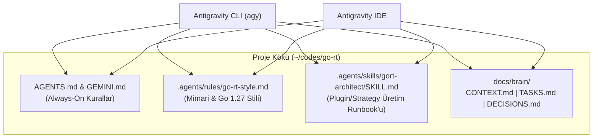

# GO-RT Vibe Coding Playbook (`agy` CLI + `antigravity-ide` Senkronizasyonu)

Bu rehber, **`agy` (Antigravity CLI)** ve **`antigravity-ide`** araçlarını aynı anda veya dönüşümlü olarak `~/codes/go-rt` üzerinde kullanırken **sıfır kodlama stili farkı** ve **ortak hafıza (Shared Brain)** elde etmen için tasarlanmıştır.

---

## 1. İki Ajan Aynı "Beyni" ve Stili Nasıl Paylaşıyor?

Antigravity ekosisteminde hem CLI (`agy`) hem de IDE (`antigravity-ide`) aynı çekirdek keşif (discovery) motorunu kullanır:



### Neden Arada Fark Oluşmaz?
1. **Otomatik Kural Yükleme (`AGENTS.md` & `GEMINI.md`):**
   İster terminalde `agy` aç, ister `antigravity-ide` içinde Sidebar Chat / Inline Edit (`Ctrl+I`) kullan; her iki araç da `~/codes/go-rt` dizininde çalıştığı anda kök dizindeki `AGENTS.md`, `GEMINI.md` ve `.agents/rules/go-rt-style.md` dosyalarını **otomatik olarak sistem prompt'una (Always-On)** dahil eder.
2. **Paylaşımlı Proje Beyni (`docs/brain/`):**
   Normalde CLI kendi geçici konuşma geçmişini `~/.gemini/antigravity-cli/brain/<id>` altında, IDE ise `~/.gemini/antigravity-ide/brain/<id>` altında tutar (bunlar SQLite ve süreç kilidi içerdiği için doğrudan birbirine symlink edilmemelidir).
   Bunun yerine `AGENTS.md` içine **"Shared Brain Protocol"** kuralı işlenmiştir:
   * Her iki ajan da işe başlamadan önce `docs/brain/CONTEXT.md` ve `docs/brain/TASKS.md` dosyalarını okur.
   * Terminalde `agy` ile **Faz 1**'i bitirdiğinde `agy` `docs/brain/TASKS.md` dosyasını günceller.
   * Hemen ardından `antigravity-ide`'ye geçip *"Sıradaki göreve devam et"* dediğinde IDE `docs/brain/TASKS.md`'yi okur ve kaldığın yerden aynı kodlama stiliyle devam eder!

---

## 2. Günlük "Vibe Coding" İş Akışı Önerisi

### Senaryo A: `agy` (CLI) ile Mimari & Çok Dosyalı Faz Geliştirme
Terminalde `~/codes/go-rt` içindeyken `agy` başlat:
* **Yeni bir faza başlarken:**
  > *"Faz 1'deki `internal/template` paketini `MASTER_PLAN.md` ve `DECISIONS.md` kurallarına göre kodla ve testlerini yaz."*
* **Derin planlama gerektiğinde:** `/plan` veya `/boost` slash komutlarını kullan.
* **Uzun süreli otonom geliştirme için:** `/goal` komutunu kullanarak tüm bir fazın testleri geçene kadar çalışmasını sağla.

### Senaryo B: `antigravity-ide` ile İnce Ayar, Refactoring ve Görsel İnceleme
* **Inline Edit (`Ctrl+I`):** Bir fonksiyonu seçip *"Bunu ADR-002'ye göre 12 satırın altına indir ve yardımcı fonksiyonlara böl"* diyebilirsin.
* **Sidebar Agent:** *"Shared brain `TASKS.md` dosyasına bak, sıradaki plugin'i `gort-architect` skill'ini kullanarak ekle"* diyebilirsin.

---

## 3. Altın Kalite Kapısı (`make check`)

Hem senin hem de ajanların her değişiklikten sonra çalıştırdığı tek komut vardır:

```bash
make check
```
Bu komut sırasıyla:
1. `go fmt ./...`
2. `go vet ./...`
3. `go test -race -v ./...`
4. Varsa `golangci-lint run`
adımlarını çalıştırır ve kod stilinin bozulmasına izin vermez.
